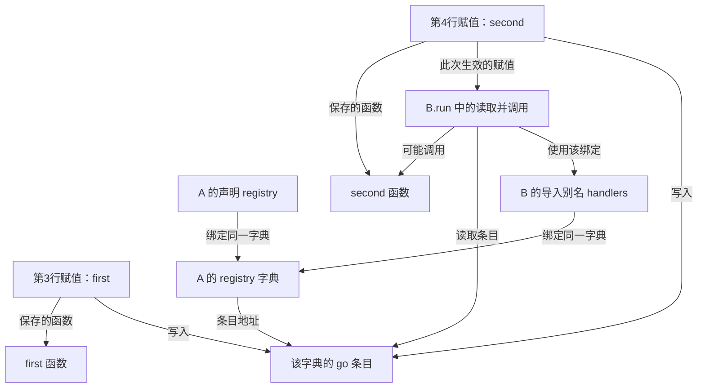

# 实际生成的字典关系小例子

固定实现：`cf4b0fbac0e11f18d53f7dbff1be8b1e40cd6505`。使用临时合成源码、离线 lexical 构建，禁止 Embedding 请求。以下由实际 SQLite 内部图记录生成，**不是 Neo4j 投影或运行时调用次数图**。

A.py：

```python
def first(): pass
def second(): pass
registry={"go":first}
registry["go"]=second
```

B.py：

```python
from a import registry as handlers
def run(): handlers["go"]()
```

实际内部节点 7 个，关系 11 条；另引用已有函数节点 2 个。两次赋值都保留，但仅第4行的赋值通过 REACHES 连接到这次读取；调用目标为 second。



字典声明和导入别名通过 BINDS 指向同一个字典。go 条目属于该字典；它不是全项目共享的 go 字符串节点。原始身份、字段和关系见 [dictionary-flow-example.json](dictionary-flow-example.json)。此例仅展示已支持的固定字符串 key、直线写入和直接导入，不能推出任意动态字典都支持局部更新。
